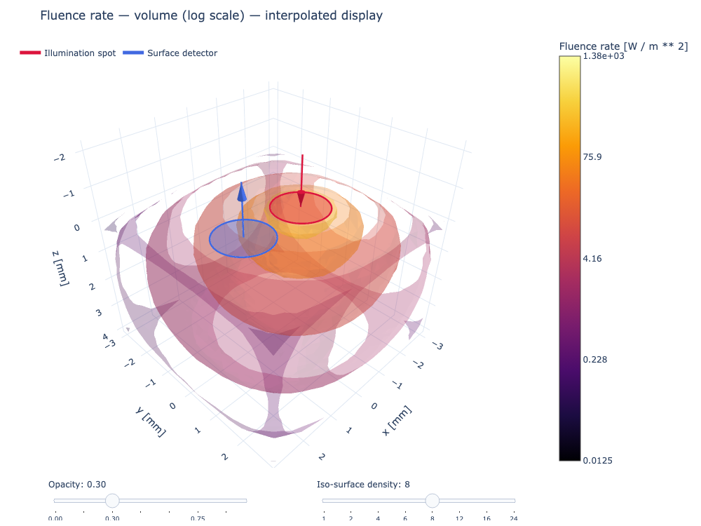
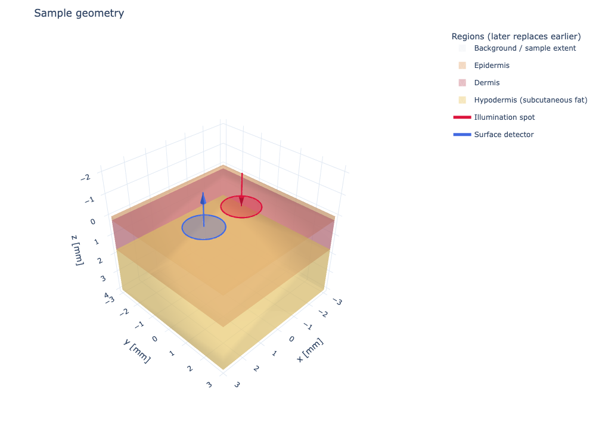
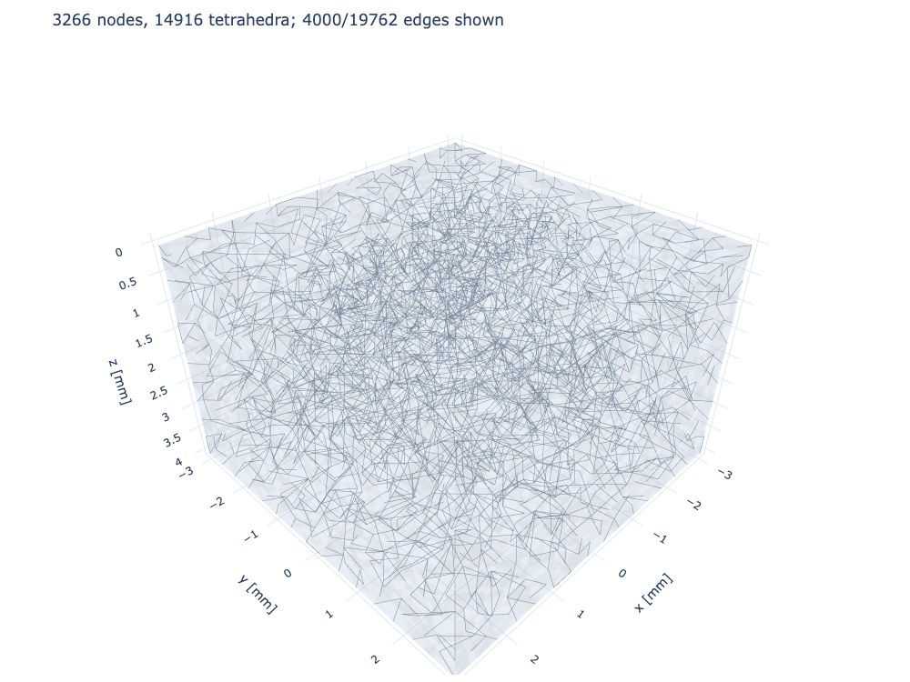
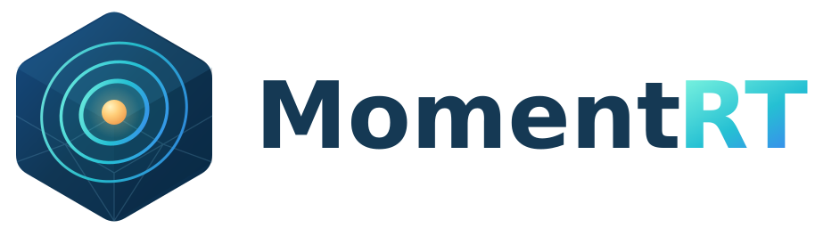

|logo|

.. list-table::
   :widths: 35 65
   :header-rows: 1

   * - Badge
     - Status
   * - Python versions
     - |python|
   * - Documentation
     - |docs|
   * - Tests
     - |tests|
   * - Coverage workflow
     - |coverage|
   * - PyPI package
     - |pypi|
   * - PyPI downloads
     - |pypi_downloads|
   * - Anaconda package
     - |anaconda|
   * - Anaconda downloads
     - |anaconda_downloads|
   * - Latest Anaconda release
     - |anaconda_date|

MomentRT
========

**MomentRT** is a Python library for deterministic light transport in
scattering media. It is designed for biomedical optics workflows such as
exploring how layered skin, diffuse illumination, and a contact detector
influence the light reaching a sensor.

Define the tissue, source, detector, boundary conditions, mesh, and transport
model as separate objects. MomentRT solves for unit-bearing optical fields and
reports detector power and energy-balance diagnostics. Its general-purpose
transport API also supports nonbiological media and instruments.

   A P1 finite-element solution for an illustrative three-layer skin sample.
   The colored volume shows fluence interpolated from the nodal solution onto
   a display grid. `Explore
   the interactive example <https://martinpdes.github.io/MomentRT/docs/latest/gallery/getting_started/skin_contact.html>`_.

What you can model
------------------

* **Tissue and phantoms:** finite layered samples with inclusions, named skin
  models, and user-supplied monochromatic or wavelength-dependent materials.
* **Contact instruments:** diffuse disk or full-face illumination and circular
  detector apertures with explicit orientation and angular acceptance.
* **Light transport:** analytical infinite-medium P1 and finite-sample P1,
  SP3, and full three-dimensional P3 angular-moment models.
* **Time-resolved transport:** coupled transient P1 fluence and current for
  explicit diffuse pulse profiles, with time-resolved contact-detector power.
* **Spectral response:** monochromatic sweeps, source spectra, and linear
  detector responsivity for broadband optical power and photocurrent.
* **Inspection and verification:** interactive 3D fields, sample sections,
  sampled footprint areas, energy diagnostics, and detector mesh studies.

Install
-------

.. code-block:: console

   python -m pip install MomentRT

Or install from conda:

.. code-block:: console

   conda install -c martinpdes -c conda-forge momentrt

Skin contact-sensor example
---------------------------

This complete example constructs a finite skin sample and a source and detector
on its upper face, refines a tetrahedral mesh around the contacts, and solves
with P1. The preset contains coefficients near **850 nm** interpolated from
one ex vivo skin dataset; its dimensions and optical properties are
illustrative rather than patient-specific.

.. code-block:: python

   import MomentRT
   from MomentRT.models.skin import ShimojoThreeLayer850nm

   ureg = MomentRT.ureg

   sample = ShimojoThreeLayer850nm(
       origin=(-3, -3, 0) * ureg.mm,
       size=(6, 6, 4) * ureg.mm,
   )

   source = MomentRT.source.SurfaceSource.on_face(
       sample=sample,
       face="z_min",
       coordinates=(-1, 0) * ureg.mm,
       radius=0.8 * ureg.mm,
       wavelength=850 * ureg.nm,
       optical_power=1 * ureg.mW,
   )

   detector = MomentRT.detector.SurfaceDetector.on_face(
       sample=sample,
       face="z_min",
       coordinates=(1, 0) * ureg.mm,
       radius=0.8 * ureg.mm,
       orientation="outward_normal",
       acceptance_angle=90 * ureg.degree,
   )

   mesh = MomentRT.mesh.TetrahedralMesh.from_sample(
       sample=sample,
       resolution=0.4 * ureg.mm,
   )
   mesh.refine_near(
       objects=[source, detector],
       resolution=0.2 * ureg.mm,
       distance=0.3 * ureg.mm,
   )

   solver = MomentRT.transport.P1(
       boundaries=MomentRT.boundary.Boundaries.uniform(
           condition=MomentRT.boundary.RobinBoundary(effective_reflectance=0),
       ),
   )
   simulation = MomentRT.simulation.Simulation(
       medium=sample,
       source=source,
       mesh=mesh,
       solver=solver,
       detectors={"contact": detector},
   )

   result = simulation.run()
   measurement = result.detectors["contact"]

   print(f"Collected power: {measurement.collected_power.to('uW'):~P}")
   print(f"Sampled source area: {result.source_sampled_area.to('mm^2'):~P}")
   print(f"Geometric source area: {result.source_geometric_area.to('mm^2'):~P}")
   print(f"Sampled detector area: {measurement.sampled_area.to('mm^2'):~P}")
   print(f"Geometric detector area: {measurement.geometric_area.to('mm^2'):~P}")
   print(f"Minimum nodal fluence: {result.fluence.values.min().to('W/m^2'):~P}")

   system_figure = simulation.plot_system(show=False)
   mesh_figure = mesh.plot(max_edges=4000, show=False)
   fluence_figure = result.fluence.plot(
       view="volume",
       scale="log",
       display_resolution=0.3 * ureg.mm,
       opacity=0.3,
       overlays=[source, detector],
       show=False,
   )
   fluence_figure.show()

The figure objects are Plotly figures; call ``.show()`` on any of them to
rotate, zoom, and inspect values interactively. The complete `executable
example <https://martinpdes.github.io/MomentRT/docs/latest/gallery/getting_started/skin_contact.html>`_
includes the same configuration and generated figures.

   The skin construction and contact footprints. Positive z points into the
   sample. Transparent layer surfaces show the construction geometry.

   Tetrahedral mesh refined near the source and detector. Only a subset of
   edges is displayed; the solve uses the full mesh.

Interpreting the result
-----------------------

* **Skin properties:** the preset uses a shared refractive index and fixed
  coefficients interpolated to 850 nm from Shimojo et al. (2020),
  doi:10.1117/1.JBO.25.4.045002. Individual skin properties, blood content,
  and optical behavior vary. Use explicit or spectral materials when needed.
* **Source and boundaries:** surface-source power is diffuse power already
  coupled into the sample. The model does not simulate collimated LED
  propagation or specular entry losses. Robin effective reflectance is a
  supplied diffuse partial-current coefficient, not a Fresnel value inferred
  from refractive index. Finite solvers currently reject internal index jumps.
* **Detector:** the circular aperture integrates escaping irradiance using a
  Lambertian angular approximation. It is not a Fresnel-resolved radiance or
  a simulation of external detector optics.
* **Accuracy:** P1, SP3, and P3 are distinct approximations to transport, not
  full radiative transfer. Check mesh and source/detector footprint convergence,
  and compare the intended geometry against an independent transport reference
  or measurements. Energy balance and footprint-area agreement alone do not
  establish physical accuracy, especially near illumination. Negative nodal
  values can occur as numerical artifacts; they are reported, not clipped.

The `scientific guide <https://martinpdes.github.io/MomentRT/docs/latest/theory.html>`_
explains the equations and limitations, and the `detector convergence guide
<https://martinpdes.github.io/MomentRT/docs/latest/convergence.html>`_ shows how
to examine mesh refinement.

Explore further
---------------

* `Example gallery <https://martinpdes.github.io/MomentRT/docs/latest/gallery/index.html>`_:
  sample construction, meshes, contact sensors, spectral calculations, and
  comparisons of transport models.
* `Seven-fiber skin probe <https://martinpdes.github.io/MomentRT/docs/latest/gallery/sources_and_detectors/seven_fiber_skin.html>`_:
  six illumination fibers and one collection aperture on layered skin.
* `Spectral modeling <https://martinpdes.github.io/MomentRT/docs/latest/spectral.html>`_:
  spectral materials, source power density, detector responsivity, and
  wavelength-integration convergence.
* `Model selection <https://martinpdes.github.io/MomentRT/docs/latest/model_selection.html>`_:
  choose between the available approximations and review their limits.

Development and citation
------------------------

To work on the package or build the executable documentation locally:

.. code-block:: console

   git clone https://github.com/MartinPdeS/MomentRT.git
   cd MomentRT
   python3 -m venv .venv
   .venv/bin/python -m pip install -e ".[testing,documentation,dev,release]"
   make check typecheck docstring-check PYTHON=.venv/bin/python
   make docs PYTHON=.venv/bin/python

See the `contributor guide <https://github.com/MartinPdeS/MomentRT/blob/master/CONTRIBUTING.rst>`_
and `changelog <https://github.com/MartinPdeS/MomentRT/blob/master/CHANGELOG.md>`_.
MomentRT is distributed under the MIT license. If you use it in research,
cite the version recorded in `CITATION.cff
<https://github.com/MartinPdeS/MomentRT/blob/master/CITATION.cff>`_.

.. |python| image:: https://img.shields.io/pypi/pyversions/MomentRT.svg
   :alt: Python versions
   :target: https://pypi.org/project/MomentRT/
.. |docs| image:: https://github.com/MartinPdeS/MomentRT/actions/workflows/deploy_documentation.yml/badge.svg?branch=master
   :alt: Documentation build status
   :target: https://martinpdes.github.io/MomentRT/
.. |tests| image:: https://github.com/MartinPdeS/MomentRT/actions/workflows/tests.yml/badge.svg?branch=master
   :alt: Test workflow status
   :target: https://github.com/MartinPdeS/MomentRT/actions/workflows/tests.yml
.. |coverage| image:: https://github.com/MartinPdeS/MomentRT/actions/workflows/deploy_coverage.yml/badge.svg?branch=master
   :alt: Coverage workflow status
   :target: https://github.com/MartinPdeS/MomentRT/actions/workflows/deploy_coverage.yml
.. |pypi| image:: https://img.shields.io/pypi/v/MomentRT.svg
   :alt: PyPI version
   :target: https://pypi.org/project/MomentRT/
.. |pypi_downloads| image:: https://img.shields.io/pypi/dm/MomentRT.svg
   :alt: Monthly PyPI downloads
   :target: https://pypi.org/project/MomentRT/
.. |anaconda| image:: https://anaconda.org/martinpdes/momentrt/badges/version.svg
   :alt: Anaconda version
   :target: https://anaconda.org/martinpdes/momentrt
.. |anaconda_downloads| image:: https://anaconda.org/martinpdes/momentrt/badges/downloads.svg
   :alt: Anaconda downloads
   :target: https://anaconda.org/martinpdes/momentrt
.. |anaconda_date| image:: https://anaconda.org/martinpdes/momentrt/badges/latest_release_relative_date.svg
   :alt: Latest Anaconda release date
   :target: https://anaconda.org/martinpdes/momentrt
