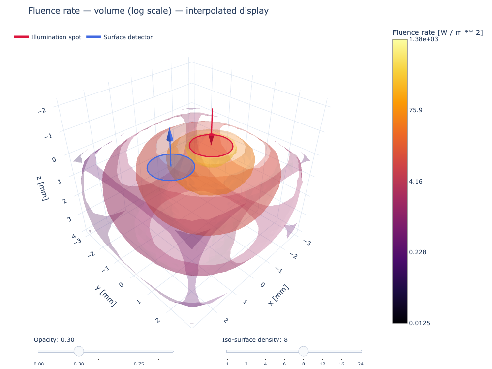

MomentRT
========

.. list-table::
   :width: 100%
   :widths: 35 65
   :header-rows: 1

   * - Badge
     - Status
   * - Python versions
     - |mps-python|
   * - Documentation
     - |mps-docs|
   * - Tests
     - |mps-ci| |mps-coverage|
   * - PyPI
     - |mps-pypi| |mps-downloads|
   * - Conda
     - |mps-conda| |mps-conda-downloads| |mps-conda-release|

Python tools for deterministic light transport in scattering media using diffusion and spherical-harmonic finite-element models.

Model diffuse fluence in scattering materials and the power collected by a contact
sensor. The layered-skin example uses coefficients from one ex vivo dataset near 850
nm. Its P1 and detector approximations need independent validation for each intended
sensor.

See the `usage guide <https://github.com/MartinPdeS/MomentRT/blob/HEAD/USAGE.rst>`__ for further examples and implementation details.

Installation
------------

Requires Python ``>=3.11``.

.. code-block:: console

   $ python -m pip install MomentRT

Install from the ``martinpdes`` Conda channel:

.. code-block:: console

   $ conda install -c martinpdes momentrt

For an editable source installation:

.. code-block:: console

   $ git clone https://github.com/MartinPdeS/MomentRT.git
   $ cd MomentRT
   $ python -m pip install -e .

Model a contact sensor on layered skin
--------------------------------------

.. code-block:: python

   """
   Simulate a contact sensor on layered skin
   =========================================

   Build an illustrative three-layer skin sample, generate a tetrahedral mesh,
   and calculate diffuse fluence and the power reaching a contact detector. The
   material coefficients describe one ex vivo dataset near 850 nm, not a
   universal or patient-specific skin model. P1 and the Lambertian detector model
   are approximations and require independent validation for the intended sensor.
   """

   # sphinx_gallery_thumbnail_path = '_static/images/gallery_systems/skin_contact.png'
   import MomentRT
   from MomentRT.models.skin import ShimojoThreeLayer850nm

   ureg = MomentRT.ureg

   # %%
   # Build the sample and contact sensor
   # -----------------------------------
   # The preset uses 0.2 mm epidermis, 1.5 mm dermis, and a hypodermis background.
   # This 4 mm sample clips the requested hypodermis layer to 2.3 mm. Source
   # optical power is diffuse power already coupled into the tissue.

   sample = ShimojoThreeLayer850nm(
       origin=(-3, -3, 0) * ureg.mm,
       size=(6, 6, 4) * ureg.mm,
   )
   source = MomentRT.source.SurfaceSource.on_face(
       sample=sample,
       face="z_min",
       coordinates=(-1, 0) * ureg.mm,
       radius=0.8 * ureg.mm,
       wavelength=850 * ureg.nm,
       optical_power=1 * ureg.mW,
   )
   detector = MomentRT.detector.SurfaceDetector.on_face(
       sample=sample,
       face="z_min",
       coordinates=(1, 0) * ureg.mm,
       radius=0.8 * ureg.mm,
       orientation="outward_normal",
       acceptance_angle=90 * ureg.degree,
   )

   # %%
   # Generate and inspect the mesh
   # -----------------------------
   # Refine near the contacts to sample their circular footprints. The plot
   # displays a subset of tetrahedral edges, not every element. Resolution and
   # source/detector sampling need a separate mesh-convergence study.

   mesh = MomentRT.mesh.TetrahedralMesh.from_sample(
       sample=sample,
       resolution=0.4 * ureg.mm,
   )
   mesh.refine_near(
       objects=[source, detector],
       resolution=0.2 * ureg.mm,
       distance=0.3 * ureg.mm,
   )
   solver = MomentRT.transport.P1(
       boundaries=MomentRT.boundary.Boundaries.uniform(
           condition=MomentRT.boundary.RobinBoundary(effective_reflectance=0),
       ),
   )
   simulation = MomentRT.simulation.Simulation(
       medium=sample,
       source=source,
       mesh=mesh,
       solver=solver,
       detectors={"contact": detector},
   )

   system_figure = simulation.plot_system(show=False)
   mesh_figure = mesh.plot(max_edges=4000, show=False)
   print(f"Tetrahedra: {len(mesh.tetrahedra)}")

   # %%
   # Solve and inspect the results
   # -----------------------------
   # The detector integrates sampled escaping irradiance over its aperture using
   # a Lambertian angular model. The displayed volume is interpolated from nodal
   # FEM fluence onto a separate grid. Neither visualization nor energy balance
   # establishes spatial convergence or P1 accuracy near the source.

   result = simulation.run()
   measurement = result.detectors["contact"]
   print(f"Collected power: {measurement.collected_power.to('uW'):~P}")
   print(f"Sampled source area: {result.source_sampled_area.to('mm^2'):~P}")
   print(f"Geometric source area: {result.source_geometric_area.to('mm^2'):~P}")
   print(f"Sampled detector area: {measurement.sampled_area.to('mm^2'):~P}")
   print(f"Geometric detector area: {measurement.geometric_area.to('mm^2'):~P}")
   print(f"Minimum nodal fluence: {result.fluence.values.min().to('W/m^2'):~P}")

   gallery_system_figure = result.fluence.plot(
       view="volume",
       scale="log",
       display_resolution=0.3 * ureg.mm,
       opacity=0.3,
       overlays=[source, detector],
       show=False,
   )

   Simulated fluence in the layered-skin contact-sensor model.

Documentation
-------------

Use the `MomentRT documentation <https://martinpdes.github.io/MomentRT/docs/latest/>`__ to work through
examples and look up the inputs and return values of individual functions.

Citation
--------

Cite the version used in your calculations with the `software citation metadata <https://github.com/MartinPdeS/MomentRT/blob/HEAD/CITATION.cff>`__.

Contributing
------------

Bug reports, worked examples, and documentation corrections are welcome.
To set up a development checkout and run the tests, follow the `contributing guide <https://github.com/MartinPdeS/MomentRT/blob/HEAD/CONTRIBUTING.rst>`__.

Contact
-------

For questions, contact `Martin Poinsinet de Sivry-Houle <mailto:martin.poinsinet.de.sivry@gmail.com?subject=MomentRT>`__.

License
-------

MomentRT is licensed under `MIT <https://github.com/MartinPdeS/MomentRT/blob/HEAD/LICENSE>`__.

.. |mps-python| image:: https://img.shields.io/pypi/pyversions/momentrt.svg
   :alt: Supported Python versions
   :target: https://pypi.org/project/momentrt/

.. |mps-pypi| image:: https://img.shields.io/pypi/v/momentrt.svg
   :alt: PyPI version
   :target: https://pypi.org/project/momentrt/

.. |mps-downloads| image:: https://img.shields.io/pypi/dm/momentrt.svg
   :alt: Monthly PyPI downloads
   :target: https://pypistats.org/packages/momentrt

.. |mps-docs| image:: https://github.com/MartinPdeS/MomentRT/actions/workflows/deploy_documentation.yml/badge.svg
   :alt: Documentation
   :target: https://martinpdes.github.io/MomentRT/docs/latest/

.. |mps-ci| image:: https://github.com/MartinPdeS/MomentRT/actions/workflows/tests.yml/badge.svg
   :alt: Tests
   :target: https://github.com/MartinPdeS/MomentRT/actions/workflows/tests.yml

.. |mps-conda| image:: https://anaconda.org/martinpdes/momentrt/badges/version.svg
   :alt: Anaconda version
   :target: https://anaconda.org/martinpdes/momentrt

.. |mps-conda-downloads| image:: https://anaconda.org/martinpdes/momentrt/badges/downloads.svg
   :alt: Anaconda downloads
   :target: https://anaconda.org/martinpdes/momentrt

.. |mps-conda-release| image:: https://anaconda.org/martinpdes/momentrt/badges/latest_release_relative_date.svg
   :alt: Latest Anaconda release
   :target: https://anaconda.org/martinpdes/momentrt
