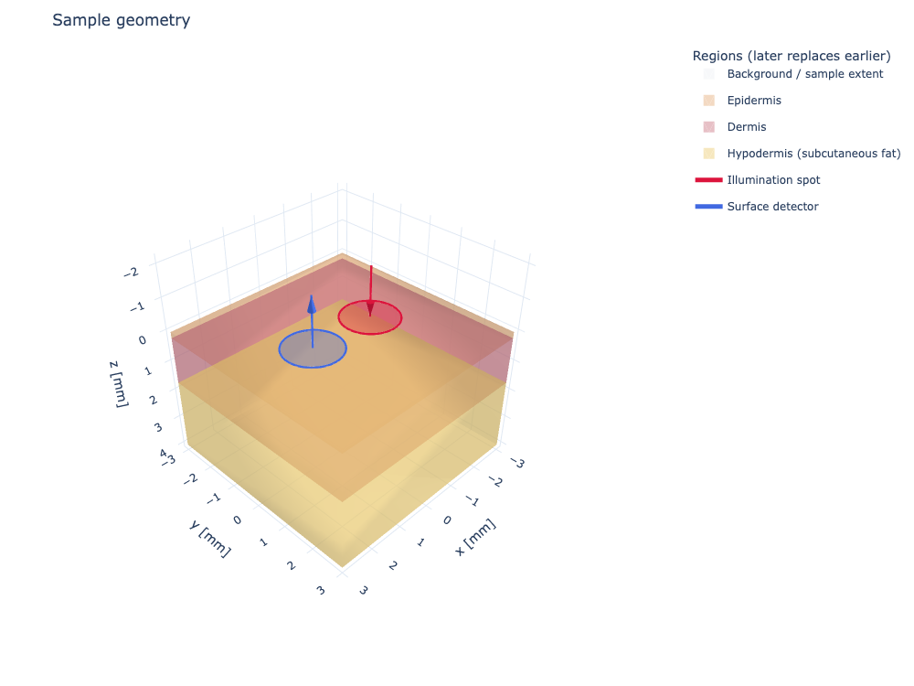
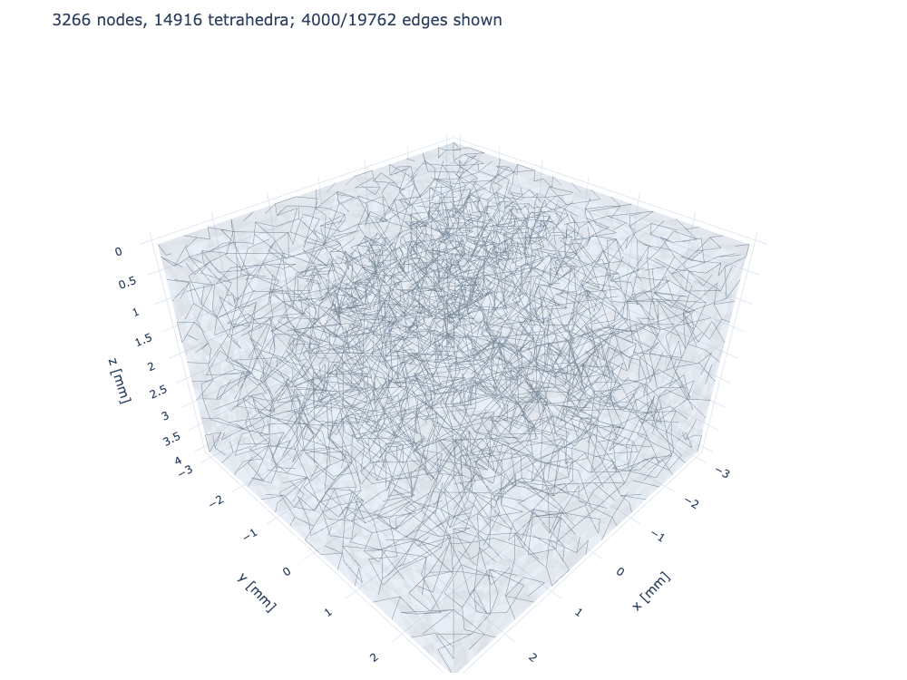

MomentRT usage guide
====================

Skin contact-sensor example
---------------------------

This complete example constructs a finite skin sample and a source and detector
on its upper face, refines a tetrahedral mesh around the contacts, and solves
with P1. The preset contains coefficients near **850 nm** interpolated from
one ex vivo skin dataset; its dimensions and optical properties are
illustrative rather than patient-specific.

.. code-block:: python

   import MomentRT
   from MomentRT.models.skin import ShimojoThreeLayer850nm

   ureg = MomentRT.ureg

   sample = ShimojoThreeLayer850nm(
       origin=(-3, -3, 0) * ureg.mm,
       size=(6, 6, 4) * ureg.mm,
   )

   source = MomentRT.source.SurfaceSource.on_face(
       sample=sample,
       face="z_min",
       coordinates=(-1, 0) * ureg.mm,
       radius=0.8 * ureg.mm,
       wavelength=850 * ureg.nm,
       optical_power=1 * ureg.mW,
   )

   detector = MomentRT.detector.SurfaceDetector.on_face(
       sample=sample,
       face="z_min",
       coordinates=(1, 0) * ureg.mm,
       radius=0.8 * ureg.mm,
       orientation="outward_normal",
       acceptance_angle=90 * ureg.degree,
   )

   mesh = MomentRT.mesh.TetrahedralMesh.from_sample(
       sample=sample,
       resolution=0.4 * ureg.mm,
   )
   mesh.refine_near(
       objects=[source, detector],
       resolution=0.2 * ureg.mm,
       distance=0.3 * ureg.mm,
   )

   solver = MomentRT.transport.P1(
       boundaries=MomentRT.boundary.Boundaries.uniform(
           condition=MomentRT.boundary.RobinBoundary(effective_reflectance=0),
       ),
   )
   simulation = MomentRT.simulation.Simulation(
       medium=sample,
       source=source,
       mesh=mesh,
       solver=solver,
       detectors={"contact": detector},
   )

   result = simulation.run()
   measurement = result.detectors["contact"]

   print(f"Collected power: {measurement.collected_power.to('uW'):~P}")
   print(f"Sampled source area: {result.source_sampled_area.to('mm^2'):~P}")
   print(f"Geometric source area: {result.source_geometric_area.to('mm^2'):~P}")
   print(f"Sampled detector area: {measurement.sampled_area.to('mm^2'):~P}")
   print(f"Geometric detector area: {measurement.geometric_area.to('mm^2'):~P}")
   print(f"Minimum nodal fluence: {result.fluence.values.min().to('W/m^2'):~P}")

   system_figure = simulation.plot_system(show=False)
   mesh_figure = mesh.plot(max_edges=4000, show=False)
   fluence_figure = result.fluence.plot(
       view="volume",
       scale="log",
       display_resolution=0.3 * ureg.mm,
       opacity=0.3,
       overlays=[source, detector],
       show=False,
   )
   fluence_figure.show()

The figure objects are Plotly figures; call ``.show()`` on any of them to
rotate, zoom, and inspect values interactively. The complete `executable
example <https://martinpdes.github.io/MomentRT/docs/latest/gallery/getting_started/skin_contact.html>`_
includes the same configuration and generated figures.

   The skin construction and contact footprints. Positive z points into the
   sample. Transparent layer surfaces show the construction geometry.

   Tetrahedral mesh refined near the source and detector. Only a subset of
   edges is displayed; the solve uses the full mesh.

Interpreting the result
-----------------------

* **Skin properties:** the preset uses a shared refractive index and fixed
  coefficients interpolated to 850 nm from Shimojo et al. (2020),
  doi:10.1117/1.JBO.25.4.045002. Individual skin properties, blood content,
  and optical behavior vary. Use explicit or spectral materials when needed.
* **Source and boundaries:** surface-source power is diffuse power already
  coupled into the sample. The model does not simulate collimated LED
  propagation or specular entry losses. Robin effective reflectance is a
  supplied diffuse partial-current coefficient, not a Fresnel value inferred
  from refractive index. Finite solvers currently reject internal index jumps.
* **Detector:** the circular aperture integrates escaping irradiance using a
  Lambertian angular approximation. It is not a Fresnel-resolved radiance or
  a simulation of external detector optics.
* **Accuracy:** P1, SP3, and P3 are distinct approximations to transport, not
  full radiative transfer. Check mesh and source/detector footprint convergence,
  and compare the intended geometry against an independent transport reference
  or measurements. Energy balance and footprint-area agreement alone do not
  establish physical accuracy, especially near illumination. Negative nodal
  values can occur as numerical artifacts; they are reported, not clipped.

The `scientific guide <https://martinpdes.github.io/MomentRT/docs/latest/theory.html>`_
explains the equations and limitations, and the `detector convergence guide
<https://martinpdes.github.io/MomentRT/docs/latest/convergence.html>`_ shows how
to examine mesh refinement.

Explore further
---------------

* `Example gallery <https://martinpdes.github.io/MomentRT/docs/latest/gallery/index.html>`_:
  sample construction, meshes, contact sensors, spectral calculations, and
  comparisons of transport models.
* `Seven-fiber skin probe <https://martinpdes.github.io/MomentRT/docs/latest/gallery/sources_and_detectors/seven_fiber_skin.html>`_:
  six illumination fibers and one collection aperture on layered skin.
* `Spectral modeling <https://martinpdes.github.io/MomentRT/docs/latest/spectral.html>`_:
  spectral materials, source power density, detector responsivity, and
  wavelength-integration convergence.
* `Model selection <https://martinpdes.github.io/MomentRT/docs/latest/model_selection.html>`_:
  choose between the available approximations and review their limits.
