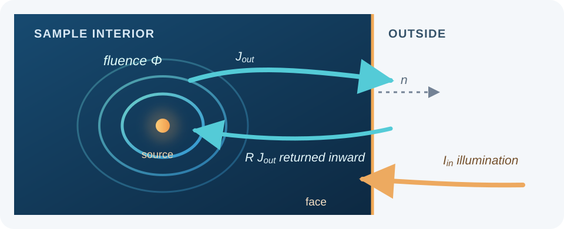

Finite-sample P1 solver
=======================

This chapter derives the boundary condition and finite-element equations
used by ``Diffusion``. It starts from the P1 transport model in
:doc:`theory`, explains the meaning of every boundary quantity, and follows
the weak equation through tetrahedral assembly and power accounting.

What problem does the finite solver solve?
------------------------------------------

The unknown :math:`\Phi(\mathbf r)` is steady fluence rate inside a finite
rectangular sample. The diffusion current is

.. math::

   \mathbf J=-D\nabla\Phi,
   \qquad
   D=\frac{1}{3(\mu_a+\mu_s')}.

In a sample with no light generated internally, conservation of radiant power
gives :math:`\nabla\cdot\mathbf J+\mu_a\Phi=0`. Substituting Fick's law,
:math:`\mathbf J=-D\nabla\Phi`, produces the finite-domain equation

.. math::

   -\nabla\cdot(D\nabla\Phi)+\mu_a\Phi=0
   \qquad\text{inside }\Omega.

This equation comes from the first two angular moments of the radiative
transfer equation and the P1 closure; :doc:`theory` derives those steps. The
finite sample has no point source in its interior. Illumination enters through
one boundary face, and all six faces must have an explicitly selected
condition.

What a Robin face represents
----------------------------

A Robin condition relates the fluence on a surface to the net current through
that surface. Here it represents a diffuse optical boundary: some diffuse
radiation reaching the face is reflected back into the sample, some escapes,
and a user may supply additional diffuse illumination entering the sample.
It is a model for angularly diffuse light at a boundary, not a model of a
collimated beam refracting across an interface.

The direction convention matters. The outward unit normal is
:math:`\mathbf n`; positive :math:`\mathbf J\cdot\mathbf n` means net power
is leaving the sample. Define the outgoing and incoming partial currents as

.. math::

   J_{\mathrm{out}}=
   \int_{\mathbf s\cdot\mathbf n>0}
      (\mathbf s\cdot\mathbf n)L\,d\Omega,
   \qquad
   J_{\mathrm{in}}=
   \int_{\mathbf s\cdot\mathbf n<0}
      -(\mathbf s\cdot\mathbf n)L\,d\Omega.

Both are nonnegative irradiances in :math:`\mathrm{W\,m^{-2}}`. They measure
the inward or outward part of the directional light flow; the net normal
current is their difference,
:math:`\mathbf J\cdot\mathbf n=J_{\mathrm{out}}-J_{\mathrm{in}}`.

   The Robin model balances outgoing diffuse current, its reflected fraction,
   and externally prescribed incoming diffuse current at the sample face.

Where the Robin coefficients come from
---------------------------------------

P1 approximates the angular radiance at the face by

.. math::

   L(\mathbf r,\mathbf s)\approx
   \frac{1}{4\pi}\left[\Phi(\mathbf r)+3\mathbf s\cdot\mathbf J(\mathbf r)\right].

Apply this expression to the two half-spheres on either side of the face.
Writing :math:`J_n=\mathbf J\cdot\mathbf n` and integrating over directions
gives

.. math::

   J_{\mathrm{out}}=\frac{\Phi}{4}+\frac{J_n}{2},
   \qquad
   J_{\mathrm{in}}=\frac{\Phi}{4}-\frac{J_n}{2}.

Equivalently, the P1 half-range relation is

.. math::

   \Phi=2(J_{\mathrm{out}}+J_{\mathrm{in}}),
   \qquad
   J_n=J_{\mathrm{out}}-J_{\mathrm{in}}.

MomentRT uses the following diffuse reflection model at a face:

.. math::

   J_{\mathrm{in}}=R J_{\mathrm{out}}+I_{\mathrm{in}}.

Here :math:`R` is the effective fraction of internally outgoing diffuse
partial current returned inward by the boundary. :math:`I_{\mathrm{in}}` is
an externally specified incoming diffuse partial-current irradiance, already
coupled into the sample. Substituting this relation into the P1 half-range
equations and solving for the net current gives

.. math::

   \mathbf J\cdot\mathbf n
   =\frac{1-R}{2(1+R)}\Phi-\frac{2}{1+R}I_{\mathrm{in}}
   =\beta\Phi-c_R I_{\mathrm{in}},

where

.. math::

   \beta=\frac{1-R}{2(1+R)},
   \qquad
   c_R=\frac{2}{1+R}.

Both coefficients are dimensionless, so each term in the current condition
has the same :math:`\mathrm{W\,m^{-2}}` units as :math:`\mathbf J\cdot\mathbf n`.

The first term describes current generated by fluence inside the sample and
directed outward after accounting for diffuse reflection. Its coefficient
:math:`\beta` decreases as :math:`R` increases, so a more reflective face
leaks less light for the same fluence. The second term is negative because
incoming illumination points opposite to the outward normal. :math:`c_R`
accounts for how that incoming diffuse current couples to the P1 boundary
field.

For example, the coefficients at three reflectances are:

.. list-table::
   :header-rows: 1

   * - :math:`R`
     - :math:`\beta`
     - :math:`c_R`
     - Interpretation
   * - 0
     - 1/2
     - 2
     - No internal diffuse partial current is reflected.
   * - 0.5
     - 1/6
     - 4/3
     - Half of the outgoing diffuse partial current returns.
   * - 0.9
     - 1/38
     - 20/19
     - Most outgoing diffuse partial current returns.

For instance, with :math:`R=0.5`, the boundary law becomes
:math:`\mathbf J\cdot\mathbf n=\Phi/6-(4/3)I_{\mathrm{in}}`. With no
illumination on that face, the net outward current is one sixth of its local
fluence rate. The :doc:`reflectance sweep example
<gallery/finite_samples/reflectance_sweep>` compares finite-sample fluence and
escaping power for :math:`R=0`, :math:`0.5`, and :math:`0.9`.

The net current :math:`\mathbf J\cdot\mathbf n` includes both outgoing and
incoming directions, so it is not the same as the transmitted power that
escapes to the outside. In this closure, the transmitted outgoing partial
current is

.. math::

   J_{\mathrm{escape}}=(1-R)J_{\mathrm{out}}
   =\beta\Phi-2\beta I_{\mathrm{in}}.

For an unilluminated Robin face, :math:`I_{\mathrm{in}}=0`, so its escaping
current is :math:`\beta\Phi`. On an illuminated face the known incident
contribution :math:`2\beta I_{\mathrm{in}}` must be removed from gross Robin
leakage to count only power transmitted outward. MomentRT applies exactly this
correction when it reports ``outgoing_power_by_face`` and ``escaping_power``.

In the API, :math:`R` is the dimensionless value
``RobinBoundary(effective_reflectance=R)``. The name describes the role of the
parameter in this boundary model. It is not the normal-incidence Fresnel
reflectance computed from refractive indices. MomentRT has no external
refractive-index rule that converts material properties to :math:`R`; the
caller must select an appropriate effective diffuse coefficient.

The accepted range is :math:`0\le R<1`. At :math:`R=0`, none of the outgoing
diffuse partial current returns to the sample, and
:math:`\beta=1/2`, :math:`c_R=2`. As :math:`R` approaches one, leakage tends
to zero. Use ``ReflectingBoundary`` for the separate zero-normal-current
condition :math:`\mathbf J\cdot\mathbf n=0`; it is not illuminated and adds
no boundary leakage or source terms to the solve.

What the illumination input means
---------------------------------

``SurfaceSource.optical_power`` and ``UniformSurfaceSource.optical_power``
are total diffuse optical power already entering the sample. They do not
include collimated LED propagation, specular Fresnel losses, or the design of
an illumination optic. The solver distributes this power over the configured
face and represents its incoming irradiance as :math:`I_{\mathrm{in}}`:

* ``UniformSurfaceSource`` uses :math:`I_{\mathrm{in}}=P/A` over the entire
  face, where :math:`P` is its specified optical power and :math:`A` is face
  area.
* ``SurfaceSource`` uses a circular top-hat spot. Triangle quadrature samples
  the disk; the specified power is normalized by the sampled area so its
  integral equals :math:`P`.

The face containing the source must use ``RobinBoundary``. The other five
faces may be Robin or reflecting. The source disk must fit on its face, and
the Cartesian mesh must span the sample exactly.

Weak form: from the continuous equation to the solve
----------------------------------------------------

The weak form is the continuous equation written in a way that only requires
first derivatives of the unknown field. This is useful for linear finite
elements, whose basis functions are continuous and piecewise linear but whose
gradients can jump at tetrahedron faces.

Start with the general diffusion equation including a possible volume source
:math:`q_0`:

.. math::

   -\nabla\cdot(D\nabla\Phi)+\mu_a\Phi=q_0.

Let :math:`v` be any test function and multiply both sides by :math:`v`. On
the divergence term use integration by parts, or equivalently the divergence
theorem applied to :math:`v\mathbf J` with :math:`\mathbf J=-D\nabla\Phi`:

.. math::

   \int_\Omega D\nabla v\cdot\nabla\Phi\,dV
   +\int_\Omega \mu_a v\Phi\,dV
   +\int_{\partial\Omega}v\,\mathbf J\cdot\mathbf n\,dA
   =\int_\Omega vq_0\,dV.

This identity also shows why the boundary current has a plus sign on the
left. Substitute :math:`\mathbf J\cdot\mathbf n=\beta\Phi-c_RI_{\mathrm{in}}`
on Robin faces. On reflecting faces the current is zero. With
:math:`\partial\Omega_R` denoting the Robin portion of the surface, the weak
problem becomes

.. math::

   \begin{aligned}
   &\int_\Omega D\nabla v\cdot\nabla\Phi\,dV
   +\int_\Omega \mu_a v\Phi\,dV
   +\int_{\partial\Omega_R}\beta v\Phi\,dA\\
   &\hspace{2em}=
   \int_\Omega vq_0\,dV
   +\int_{\partial\Omega_R}c_RvI_{\mathrm{in}}\,dA.
   \end{aligned}

MomentRT's finite solver has :math:`q_0=0`; illumination contributes only the
rightmost surface integral. The Robin fluence term adds a positive boundary
matrix to the left, and incoming light adds a boundary load to the right.
Reflecting faces add neither term. This sign arrangement is what makes
positive incoming illumination drive a positive fluence solution.

Finite-element basis and matrices
---------------------------------

``CartesianMesh.from_sample(sample=sample, shape=(n_x, n_y, n_z))`` places
nodes on the sample faces. Every Cartesian cell is split into six tetrahedra
that share one consistent body diagonal. The total number of tetrahedra is

.. math::

   N_{\mathrm{tet}}=6(n_x-1)(n_y-1)(n_z-1).

On a tetrahedron :math:`e`, represent fluence by four linear basis functions:

.. math::

   \Phi_h(\mathbf r)=\sum_{i=1}^{4}N_i(\mathbf r)\Phi_i.

The nodal coefficients :math:`\Phi_i` are the unknowns. Linear basis
gradients :math:`\nabla N_i` are constant within an element. Absorption and
reduced-scattering properties are evaluated at each tetrahedron centroid;
that element then has constant diffusion coefficient

.. math::

   D_e=\frac{1}{3(\mu_{a,e}+\mu'_{s,e})}.

Choose :math:`v=N_j` in the weak equation and substitute the basis expansion.
The element diffusion and absorption matrices are

.. math::

   K^{(e)}_{ij}=D_eV_e\nabla N_i\cdot\nabla N_j,
   \qquad
   M^{(e)}_{ij}=\mu_{a,e}\frac{V_e}{20}(1+\delta_{ij}).

The mass matrix formula is the exact integral of products of linear basis
functions over a tetrahedron. On a Robin boundary triangle :math:`f`, with
area :math:`A_f`, the exact linear-triangle boundary matrix is

.. math::

   B^{(f)}_{ij}=\beta\frac{A_f}{12}(1+\delta_{ij}).

These matrices are added into a sparse global matrix. Incoming irradiance is
integrated against each boundary basis function to form the load vector. Disk
illumination uses a three-point triangle quadrature rule; quadrature points
outside the disk receive zero irradiance. The assembled system is

.. math::

   \mathbf A\boldsymbol\Phi=\mathbf b.

More explicitly, for a global pair of nodes :math:`i,j`, assembly sums the
contributions of every element and Robin triangle containing those nodes:

.. math::

   A_{ij}=\sum_e\left(K^{(e)}_{ij}+M^{(e)}_{ij}\right)
   +\sum_{f\subset\partial\Omega_R}B^{(f)}_{ij},
   \qquad
   b_i=\sum_{f\subset\partial\Omega_R}
   \int_f c_RN_iI_{\mathrm{in}}\,dA.

The sum notation here assumes local entries are placed at the corresponding
global node indices. A reflecting triangle has no :math:`B^{(f)}` or source
load. MomentRT solves the sparse system with SciPy and checks the relative
residual :math:`\lVert\mathbf A\boldsymbol\Phi-\mathbf b\rVert/
\lVert\mathbf b\rVert` before returning the field.

After solving this sparse linear system, the fluence values are put back on
the three-dimensional mesh. Within each tetrahedron, its constant gradient
gives the element-centered current

.. math::

   \mathbf J_e=-D_e\nabla\Phi_h
   =-D_e\sum_{i=1}^{4}\Phi_i\nabla N_i.

The field is not smoothed across element faces or optical interfaces.

.. figure:: _static/images/finite-fluence-slices.png
   :align: center
   :alt: Three intersecting central planes showing logarithmic FEM fluence in a finite sample.
   :width: 85%

   The finite-sample P1 FEM solution. These are sampled mesh planes, not
   smoothed reconstructions.

One solve, step by step
-----------------------

The finite workflow follows directly from the weak equation:

#. Define the finite sample extent and assign a background material.
#. Add named layers or inclusions; later structures replace earlier materials
   where they overlap.
#. Create a Cartesian mesh spanning all six sample faces. Plan the resolution
   around thin layers, curved interfaces, and the illumination footprint.
#. Select one face as the illuminated face and specify its incoming diffuse
   power and profile.
#. Assign either a Robin or reflecting condition to each face. The illuminated
   face must be Robin. Supply an explicit ``effective_reflectance`` for every
   Robin face.
#. Split cells into tetrahedra, sample material coefficients at centroids,
   and assemble the element and boundary matrices.
#. Integrate the source over boundary triangles, solve the sparse system, and
   evaluate nodal fluence and element-centered current.
#. Check the linear residual, sampled source area, mesh refinement, and energy
   balance before interpreting the result.

.. code-block:: python

   import numpy as np

   from MomentRT import (
       CartesianMesh,
       Diffusion,
       Material,
       RobinBoundary,
       Simulation,
       StructuredMedium,
       SurfaceSource,
       ureg,
   )

   material = Material(
       absorption=0.02 / ureg.millimeter,
       reduced_scattering=1.0 / ureg.millimeter,
       refractive_index=1.4,
   )

   sample = StructuredMedium(
       origin=np.array([-4, -4, 0]) * ureg.millimeter,
       size=np.array([8, 8, 4]) * ureg.millimeter,
   )

   sample.add_background(material=material)

   mesh = CartesianMesh.from_sample(
       sample=sample,
       shape=(17, 17, 9),
   )

   source = SurfaceSource(
       face="z_min",
       position=np.array([0, 0, 0]) * ureg.millimeter,
       radius=1.5 * ureg.millimeter,
       wavelength=970 * ureg.nanometer,
       optical_power=1 * ureg.milliwatt,
   )

   boundary = RobinBoundary(effective_reflectance=0.4)

   solver = Diffusion(
       boundaries={
           "x_min": boundary,
           "x_max": boundary,
           "y_min": boundary,
           "y_max": boundary,
           "z_min": boundary,
           "z_max": boundary,
       },
   )

   simulation = Simulation(
       medium=sample,
       source=source,
       mesh=mesh,
       solver=solver,
   )

   result = simulation.run()

This compact homogeneous example illustrates the solver setup; the
:doc:`finite-sample gallery
<gallery/index>` adds layered geometry and plots the computed fields.

Material sampling and interface approximation
----------------------------------------------

``StructuredMedium`` starts with its background, then applies structures in
insertion order. Later structures replace earlier materials where they
overlap. The solver assigns material properties to an element using the
element centroid. It does not create an interface-conforming mesh. An
interface aligned with mesh planes is represented cleanly; an unaligned
planar interface or curved sphere is approximated through the centroids of
nearby elements. Refine the mesh and align important planar boundaries when
possible.

The formulation uses one continuous fluence field. MomentRT rejects internal
refractive-index jumps because it does not model refraction or the associated
interface jump conditions. Absorption and reduced scattering may still vary
between structures.

Power accounting and verification
---------------------------------

The assembled balance has a direct physical interpretation. Absorption
removes power in the volume, prescribed illumination supplies power through
the source face, and partial current leaves through the boundaries. The
reported transmitted escape removes the incident contribution from gross
Robin leakage:

.. math::

   P_{\mathrm{in}}=P_{\mathrm{abs}}+P_{\mathrm{escape}}+P_{\mathrm{residual}}.

``result.energy_balance`` reports these unit-bearing powers. Escaping power
on the source face is a transmitted partial current integrated over the
whole face; it is not the same as the net current through that face or a
detector reading. ``result.outgoing_power_by_face`` separates the integrated
escape by face.

``result.diagnostics`` reports the sparse-system relative residual, minimum
fluence, tetrahedron count, and sampled source area. A small algebraic
residual shows that the linear equations were solved accurately. A small
energy residual checks conservation and bookkeeping. Neither checks the P1
approximation against the radiative transfer equation, resolves an optical
interface automatically, or proves that the source disk is adequately
sampled. Compare independent references and refine the mesh to assess those
errors.

Limits of this boundary and transport model
-------------------------------------------

The solver is steady-state and monochromatic. It does not model Fresnel
reflection from refractive indices, collimated illumination, detector
apertures, time response, spectral integration, or inverse estimation. P1
diffusion becomes least reliable near the source footprint and sample
boundaries, in weakly scattering regions, around unresolved interfaces, and
at short source-to-detector distances. Plotting or a small algebraic residual
cannot remove those physical and discretization limits.
