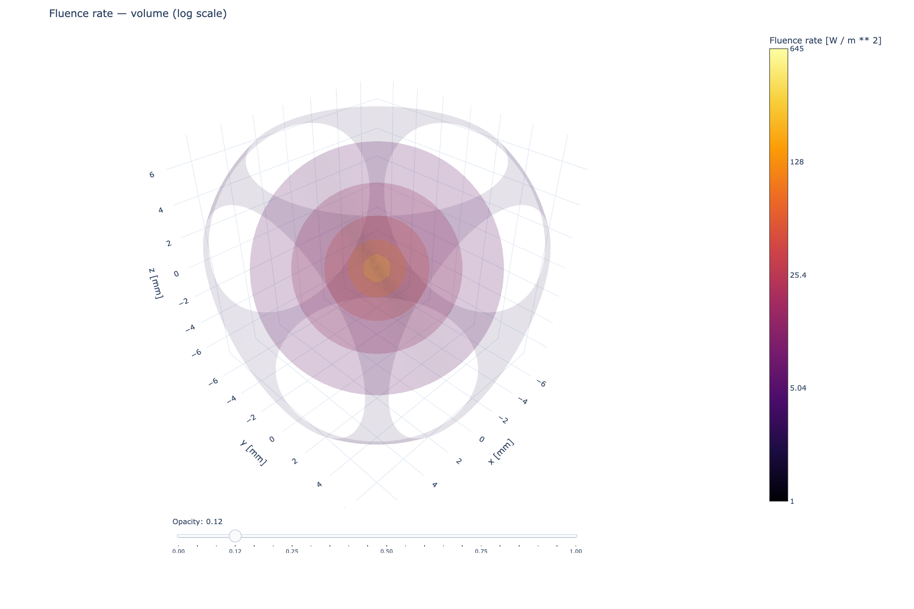
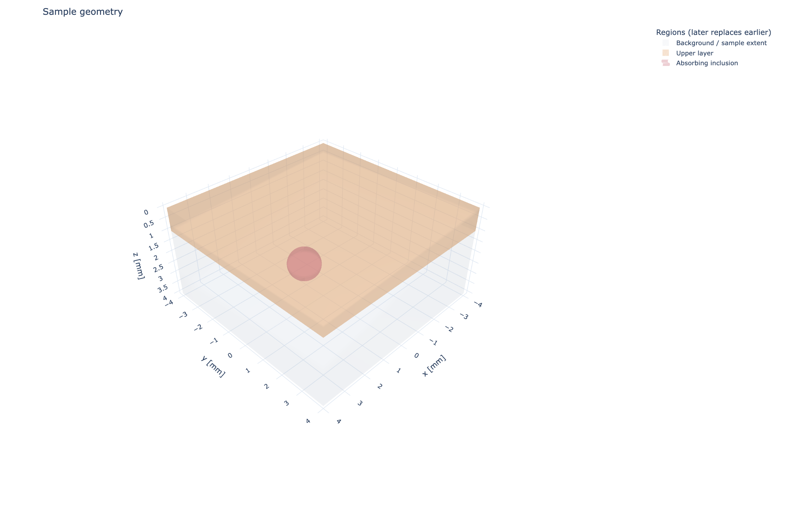
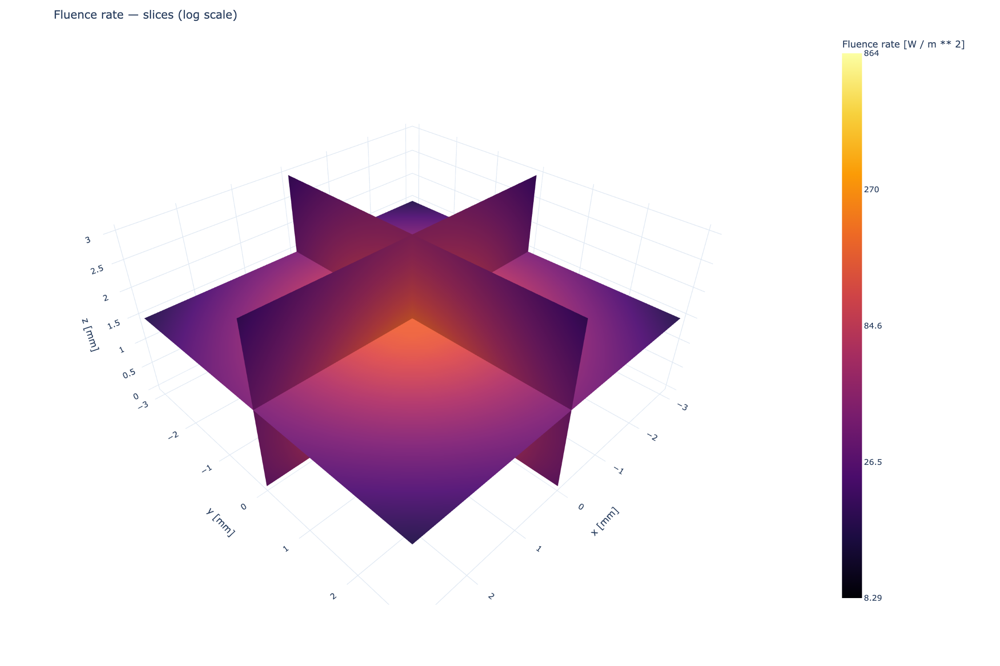

Results and visualization
==========================

Simulation results keep fields, units, and provenance together. Plotting is a
view of the computed arrays; it does not modify the numerical result.

Fluence rate
------------

``result.fluence`` is a :class:`~MomentRT.ScalarField` of nodal fluence rate
:math:`\Phi`, with units of watts per square metre. ``values`` is a Pint
quantity shaped like its associated Cartesian mesh. Infinite and finite
solutions also carry metadata describing the transport model, wavelength, and
source configuration.

The default Plotly view uses a volume trace. Its opacity slider changes the
volume transparency in the browser; ``opacity=...`` chooses the starting
value. ``scale="log"`` colors points by :math:`\log_{10}(\Phi)` while hover
labels and stored values remain in physical units. Log rendering rejects
nonpositive data instead of silently clipping it.

   A screenshot of the Plotly volume generated from a MomentRT
   ``ScalarField``. In a live figure the opacity control remains interactive.

Other scalar-field views are:

* ``view="slices"`` shows the actual central grid plane along each Cartesian
  axis. Values are not interpolated onto arbitrary section locations.
* ``view="isosurfaces"`` displays surfaces of constant field value. This can
  expose spatial structure, though nested surfaces can occlude each other.
* ``view="volume"`` integrates translucent samples through the volume. It
  gives an overall spatial impression; crowded or dense grids can take longer
  to redraw as opacity changes. ``isosurface_count`` controls the number of
  iso levels used for this rendering.

In isosurface mode, ``isosurface_count`` sets how many surface levels Plotly
extracts between the minimum and maximum display values. A larger count shows
more levels and can add detail, though nested surfaces may occlude each other
and rendering can take longer. If omitted, MomentRT keeps six levels for
``view="isosurfaces"`` and eight for ``view="volume"``.

For example:

.. code-block:: python

   figure = result.fluence.plot(
       view="volume",
       scale="log",
       opacity=0.12,
       show=False,
   )

   figure.write_html("fluence.html")

For example, request more constant-fluence surfaces:

.. code-block:: python

   figure = result.fluence.plot(
       view="isosurfaces",
       scale="log",
       opacity=0.28,
       isosurface_count=12,
       show=False,
   )

The volume view is a rendering of sampled nodal values, not a geometric
boundary or a claim that every displayed contour is resolved. Mesh refinement
and model validation remain numerical tasks.

Source and detector overlays
-----------------------------

Use ``overlays`` to place instrument geometry on the same 3D axes as a
scalar field. Sources draw their illumination marker, disk, or full-face
patch. Contact detectors draw an aperture and an outward collection axis.
For example:

.. code-block:: python

   figure = result.fluence.plot(
       view="volume",
       scale="log",
       overlays=[source, reflection_detector, transmission_detector],
       show=False,
   )

The sequence order determines drawing and legend order. Set ``name`` and
``color`` on each source or detector to control its legend entry and color:

.. code-block:: python

   figure = result.fluence.plot(
       overlays=[source, reflection_detector],
       length_unit="mm",
       show=False,
   )

All overlays use the displayed coordinate unit. Each object's related
traces share a legend group: hiding a detector hides both its aperture and
collection axis. The volume opacity slider changes only the fluence trace.
Overlays do not change the field, detector power, source configuration, or
energy accounting.

Full-face illumination needs physical sample bounds. The finite solver
records those bounds in the fluence metadata, so its fields can place a
``UniformSurfaceSource`` on the correct face. The observation window of an
infinite-medium field is not a sample boundary and is not used as one.
Explicit point, disk, and aperture coordinates can be drawn without those
physical bounds.

``simulation.plot_system()`` uses the same object-owned
``_add_to_figure(figure=..., context=...)`` hooks, keeping source and
detector styling consistent across views. These hooks are internal; the
public entry point for composing field figures is ``overlays``.

Collected-power spectra use wavelength and power axes, so geometric
overlays belong on a constituent spatial field:
``spectrum.results[2].fluence.plot(overlays=[source, detector])``.
See the :doc:`spectral detector example
<gallery/finite_samples/spectral_detectors>` for both figures.

Diffusive flux
--------------

For finite FEM simulations, ``result.flux`` is an element-centered
:class:`~MomentRT.VectorField` with units of :math:`\mathrm{W\,m^{-2}}`:

.. math::

   \mathbf J_e=-D_e\nabla\Phi\vert_e.

The gradient is constant inside each linear tetrahedron. Values are not
averaged across element faces or optical interfaces. ``result.flux.plot()``
shows a sampled set of 3D arrows; ``max_vectors`` controls how many arrows are
drawn. Their lengths are scaled for visibility and should be read as direction
and relative magnitude, not a calibrated length scale.

Sample geometry and sections
----------------------------

``sample.plot()`` displays the rectangular extent and transparent construction
surfaces for layers, boxes, and spheres. This is helpful for checking names,
placement, and overlap order, but it is not the resolved Boolean material
map. A cross-section is sampled at cell centers and resolves the same
insertion-order precedence used by material lookup.

   Named geometry primitives are shown as transparent surfaces. Later regions
   replace earlier materials in overlaps; the display is not Boolean
   subtraction.

Use ``sample.section(...)`` for numerical section data or
``sample.plot_section(...)`` for an interactive Plotly view. ``normal``
selects the plane normal and ``position`` is an absolute coordinate with
length units. Resolution gives horizontal and vertical cell counts. Thin
features may be missed unless the resolution is fine enough.

Finite-field view
-----------------

   The planes show the same finite-element nodal field through a bounded
   sample. This plot is useful for inspecting penetration with physical axes;
   it does not add detector optics or measurement apertures.

Energy and solver diagnostics
-----------------------------

For finite samples, ``result.energy_balance`` contains ``incoming_power``,
``absorbed_power``, ``escaping_power``, and ``residual_power`` as unit-bearing
quantities. ``result.outgoing_power_by_face`` separates escaping power by
sample face. This is total face-integrated power, not a detector collection
efficiency.

Configured :doc:`detectors` have a separate output:
``result.detectors[name]`` is a ``DetectorResult``, and
``result.detector_power[name]`` is its collected power.
The result includes sampled and geometric aperture areas and the angular
acceptance fraction. These are passive readouts of the escaping field;
they are not subtracted again from the energy balance.

``result.boundary_fields[face]`` contains the boundary quadrature positions,
area weights, and escaping irradiance used for collection. Its
``escaping_power`` integrates the full face. Boundary arrays are snapshots,
so later edits to source or material configurations do not change them.

For a :doc:`wavelength sweep <spectral>`, the returned spectral result keeps
one ordinary result per wavelength in ``results`` and stacked detector
powers in ``detector_power``. The wavelength vector preserves the requested
ordering; the sweep does not integrate these independent powers into a
broadband signal.

``result.diagnostics`` includes:

* ``linear_relative_residual``: relative residual of the sparse algebraic
  system after solving.
* ``minimum_fluence``: smallest nodal value; nonpositive values are reported,
  not clipped.
* ``tetrahedron_count``: number of linear tetrahedral elements.
* ``source_quadrature_area``: disk area sampled by triangle quadrature, or the
  entire face for uniform illumination.
* ``source_geometric_area``: the configured disk or face area.
* ``preparation_reused``: whether this solve reused the prepared geometry
  from an earlier wavelength in the same sweep.

These diagnostics help identify algebraic errors and under-resolved
discretization. Energy conservation is necessary for a consistent solve, but
it does not establish agreement with radiative transfer or an experiment.

The :doc:`detector convergence study <convergence>` organizes these area
diagnostics and collected-power comparisons across explicit mesh levels.
It preserves failed resolution checks and returns no recommended mesh when
the supplied fine levels do not satisfy the requested criteria.

Export
------

``ScalarField.export(path="fluence.vti")`` writes a VTK ImageData file using
optional PyVista. The export stores the scalar values, field units, coordinate
units, and field metadata. The numerical solve and Plotly figures do not
require PyVista.

Interpreting a result summary
-----------------------------

``result.summary()`` includes available model provenance, wavelength, mesh,
energy balance, footprint areas, and negative-value warnings. It says when no
convergence study is supplied. Pass a separately computed detector study using
``result.summary(convergence=study)`` to include its outcome; the caller must
check that the study applies to that result. Area agreement and a converged
mesh do not establish transport-model accuracy.
