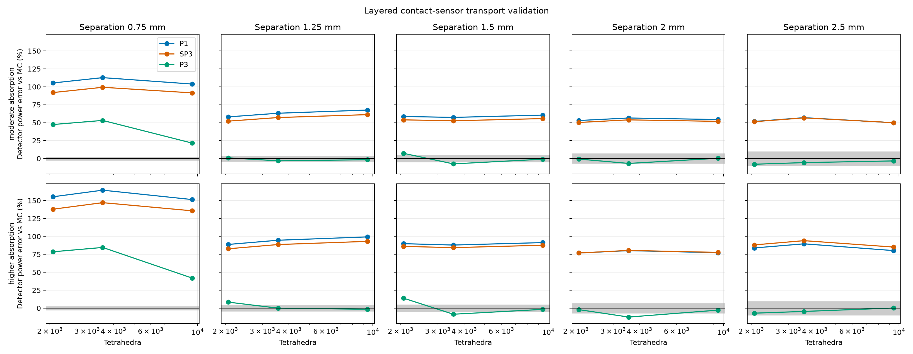
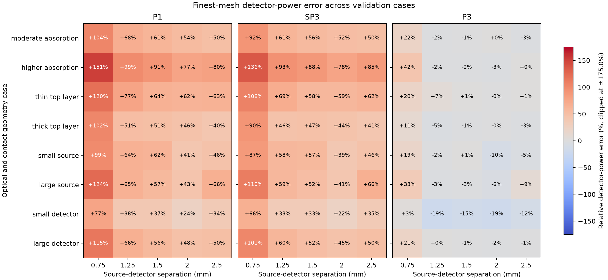

Sensor-focused model validation
===============================

This benchmark compares P1, SP3, and P3 detector-power predictions with an
independent Monte Carlo photon-transport reference across eight layered-sample
and contact-sensor cases. It varies layer thickness, optical properties,
source radius, detector radius, and five source-detector separations. The
complete JSON report records all inputs, random seeds, detector powers,
Monte Carlo standard errors, mesh sizes, sampled source and aperture areas,
and runtimes. The :doc:`executable gallery example
<gallery/sweeps_convergence/sensor_validation_cases>` visualizes these
published results.

Each case uses 850 nm wavelength, 1 mW diffuse source power, 6 mm sample width,
and a 2 mm total sample thickness. The baseline layer thicknesses are
``(0.25, 0.65, 1.10) mm``; its source and detector radii are both 0.20 mm.
Cases vary a single geometry factor around that baseline: top-layer thickness
is changed to 0.10 or 0.45 mm, source radius to 0.10 or 0.35 mm, and detector
radius to 0.10 or 0.30 mm. For thickness variants, the bottom layer changes
to keep total sample thickness at 2 mm. A separate higher-absorption case
changes the optical coefficients in all three layers. Separations are 0.75,
1.25, 1.5, 2.0, and 2.5 mm.

The heat map compares finest-mesh detector power to Monte Carlo; colors are
clipped for readability. The separate mesh-study plot shows how the baseline
and higher-absorption cases change over the three mesh levels. Read both plots
with the Monte Carlo uncertainty and area diagnostics in the JSON report.

The full reproducible inputs and reference data are available as
:download:`JSON <_static/images/sensor_validation/sensor_validation.json>`.

         source-detector separations, and two layered optical-property cases.
   :align: center
   :width: 100%

         eight layered optical and contact geometry cases.
   :align: center
   :width: 100%

Reproduce the benchmark from the repository root with::

   .venv/bin/python tools/validate_sensor_models.py

The command writes the JSON report and both plots under
``docs/source/_static/images/sensor_validation``. It uses one million photon
histories per case and deterministic case-specific seeds. Use ``--photons``
and ``--seed`` to choose another run, ``--cases`` to select named cases, or
``--output-dir`` to write elsewhere. The committed JSON records each exact
case configuration alongside the full detector-by-detector mesh study and
sampled-area diagnostics.

Reference definition and limits
-------------------------------

The independent reference launches cosine-weighted diffuse photons uniformly
over the source disk. It samples Henyey-Greenstein scattering using each
layer's anisotropy and converts reduced scattering to total scattering. It
uses continuous absorption weighting and tallies the weighted photons that
leave through each circular top-face aperture. All six sample faces transmit
without Fresnel reflection, matching the benchmark's zero-reflectance Robin
boundaries. The detector accepts the full outward hemisphere, matching the
Lambertian angular acceptance fraction of one used by these MomentRT
detectors.

These are deliberately matched boundary and detector conventions, not a
complete model of an optical instrument. The reference uses independent
photon histories and reports their sampling error; it does not include
Fresnel reflection, a collimated LED, external optics, or detector
responsivity. P1, SP3, and P3 all solve the same finite layered geometry, but
their transport approximations can differ from the angularly resolved
reference. Mesh refinement cannot remove model-form error. Read the plotted
errors together with the Monte Carlo uncertainty and area fractions in the
JSON; agreement in energy balance or sampled area alone is not evidence of
transport accuracy.

The cases are illustrative and do not span the full range of tissue structures,
optical properties, or sensor designs. They are a reproducible diagnostic
suite, not a claim of accuracy for skin or every source-detector distance.
At the finest mesh, the small-source and small-detector cases sample about 87%
of their corresponding geometric footprint areas. Treat those particular
results as under-resolved; refine the contact mesh before interpreting their
model errors as transport-approximation error.
